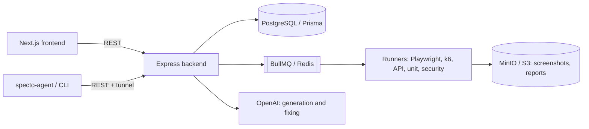

# Specto

**AI-driven test automation platform.** Describe a scenario in plain language: Specto generates the test, runs it through a queue, stores screenshots and metrics, and suggests an automatic fix when it fails.


## Features

| Test type           | Execution                         | AI generation |
| ------------------- | --------------------------------- | ------------- |
| E2E (UI)            | Playwright / Chromium             | ✅            |
| REST API            | Axios, JSON / headers assertions  | ✅ (+ cURL import) |
| Smoke               | Quick availability checks         | ✅            |
| Unit                | Jest / Vitest                     | ✅            |
| Performance         | k6                                | ✅            |
| Security            | Vulnerability scanning            | ✅            |

Around execution:

- **Auto-healing**: when a test fails, the AI analyzes the error (selector, timeout, assertion…) and proposes fixed code, with the history of attempts.
- **Flaky test detection**: a reliability score per test and recommendations to stabilize them.
- **Retry** with exponential backoff, **scheduled** runs (cron) and **notifications**.
- **Projects and teams**: accounts, members, API keys, OAuth sign-in (Google, GitHub).
- **Agent & CLI** (`specto-agent`): a tunnel to a local application during development, and running tests from a CI/CD pipeline.

## Architecture



## Stack

- **Frontend**: Next.js 14 (App Router), React, TypeScript, Tailwind CSS
- **Backend**: Node.js, Express, TypeScript, Prisma (28 models), Passport (OAuth)
- **Execution**: BullMQ + Redis, Playwright, k6
- **Storage**: PostgreSQL 16, MinIO (S3-compatible)
- **AI**: OpenAI API (test generation, auto-healing, prompt analysis)
- **Infra**: Docker Compose (6 services), GitHub Actions

## Quick start

### With Docker (recommended)

```bash
cp .env.example .env      # set at least OPENAI_API_KEY and the passwords
docker compose up -d
```

| Service        | URL                          |
| -------------- | ---------------------------- |
| Frontend       | http://localhost:3000        |
| API            | http://localhost:4000        |
| Health check   | http://localhost:4000/health |
| MinIO console  | http://localhost:9001        |

### Locally

Requirements: Node.js 18+, PostgreSQL and Redis (for example via `docker compose up -d postgres redis minio`).

```bash
npm install
cp apps/backend/.env.example apps/backend/.env
cp apps/frontend/.env.example apps/frontend/.env.local
npm run prisma:push --workspace=apps/backend
npm run dev               # frontend :3000 + backend :4000
```

### Agent & CLI

```bash
cd agent && npm install && npm run build && npm link
specto-agent login --email=you@example.com --password=***
specto-agent init         # generates specto.json
specto-agent test         # runs the project's tests (usable in CI)
```

The [`test-site/`](test-site/) folder contains a small demo application to run the tests against.

## Structure

```
specto/
├── apps/
│   ├── backend/     Express API: routes, runners, AI services, BullMQ queue, Prisma schema
│   └── frontend/    Next.js interface: dashboards, test creation and history
├── agent/           Tunnel agent + CI/CD CLI (specto-agent)
├── test-site/       Demo application
└── docker-compose.yml
```

## Scripts

| Command              | Purpose                                |
| -------------------- | -------------------------------------- |
| `npm run dev`        | Frontend and backend in watch mode     |
| `npm run build`      | Production build of both apps          |
| `npm run type-check` | TypeScript check                       |
| `npm run lint`       | Lint                                   |
| `npm test`           | Backend tests                          |

## License

[MIT](LICENSE) © Adlane Hamzaoui
