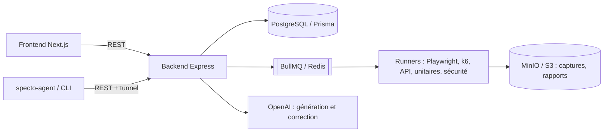

# Specto

**Plateforme de tests automatisés pilotée par l'IA.** Décrivez un scénario en langage naturel : Specto génère le test, l'exécute dans une file d'attente, stocke les captures et les métriques, et propose une correction automatique quand il échoue.


## Fonctionnalités

| Type de test        | Exécution                         | Génération IA |
| ------------------- | --------------------------------- | ------------- |
| E2E (interface)     | Playwright / Chromium             | ✅            |
| API REST            | Axios, assertions JSON / headers  | ✅ (+ import cURL) |
| Smoke               | Vérifications rapides de disponibilité | ✅       |
| Unitaires           | Jest / Vitest                     | ✅            |
| Performance         | k6                                | ✅            |
| Sécurité            | Analyse de vulnérabilités         | ✅            |

Autour de l'exécution :

- **Auto-healing** : quand un test échoue, l'IA analyse l'erreur (sélecteur, timeout, assertion…) et propose un code corrigé, avec l'historique des tentatives.
- **Détection des tests instables** : score de fiabilité par test et recommandations pour les stabiliser.
- **Retry** avec délai exponentiel, **planification** des exécutions (cron) et **notifications**.
- **Projets et équipes** : comptes, membres, clés d'API, connexion OAuth (Google, GitHub).
- **Agent & CLI** (`specto-agent`) : tunnel vers une application locale pendant le développement, et lancement des tests depuis une pipeline CI/CD.

## Architecture



## Stack

- **Frontend** : Next.js 14 (App Router), React, TypeScript, Tailwind CSS
- **Backend** : Node.js, Express, TypeScript, Prisma (28 modèles), Passport (OAuth)
- **Exécution** : BullMQ + Redis, Playwright, k6
- **Stockage** : PostgreSQL 16, MinIO (compatible S3)
- **IA** : API OpenAI (génération de tests, auto-healing, analyse de prompts)
- **Infra** : Docker Compose (6 services), GitHub Actions

## Démarrage rapide

### Avec Docker (recommandé)

```bash
cp .env.example .env      # renseignez au minimum OPENAI_API_KEY et les mots de passe
docker compose up -d
```

| Service        | URL                          |
| -------------- | ---------------------------- |
| Frontend       | http://localhost:3000        |
| API            | http://localhost:4000        |
| Health check   | http://localhost:4000/health |
| Console MinIO  | http://localhost:9001        |

### En local

Prérequis : Node.js 18+, PostgreSQL et Redis (par exemple via `docker compose up -d postgres redis minio`).

```bash
npm install
cp apps/backend/.env.example apps/backend/.env
cp apps/frontend/.env.example apps/frontend/.env.local
npm run prisma:push --workspace=apps/backend
npm run dev               # frontend :3000 + backend :4000
```

### Agent & CLI

```bash
cd agent && npm install && npm run build && npm link
specto-agent login --email=vous@example.com --password=***
specto-agent init         # génère specto.json
specto-agent test         # lance les tests du projet (utilisable en CI)
```

Le dossier [`test-site/`](test-site/) contient une petite application de démonstration sur laquelle lancer les tests.

## Structure

```
specto/
├── apps/
│   ├── backend/     API Express : routes, runners, services IA, file BullMQ, schéma Prisma
│   └── frontend/    Interface Next.js : tableaux de bord, création et historique des tests
├── agent/           Agent de tunnel + CLI CI/CD (specto-agent)
├── test-site/       Application de démonstration
└── docker-compose.yml
```

## Scripts

| Commande             | Rôle                                   |
| -------------------- | -------------------------------------- |
| `npm run dev`        | Frontend et backend en mode watch      |
| `npm run build`      | Build de production des deux apps      |
| `npm run type-check` | Vérification TypeScript                |
| `npm run lint`       | Lint                                   |
| `npm test`           | Tests du backend                       |

## Licence

[MIT](LICENSE) © Adlane Hamzaoui
